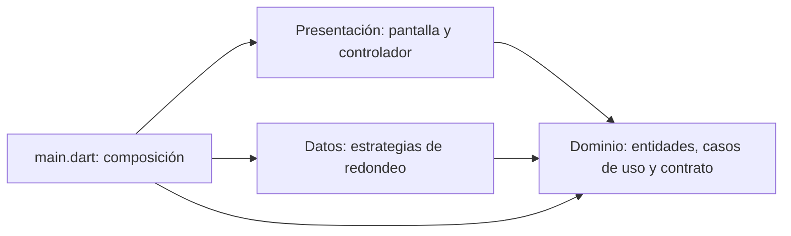

# Cuenta Clara · Deber 3

Divisor de cuenta Flutter de una pantalla, desarrollado sobre la rama `sdd`
de la participación de clase. La rama de entrega es **`deber3`**.

La propina puede estar entre 0% y 100%, incluido el límite. Si supera 100%,
se muestra **«La propina no puede superar el 100%»** y no se calcula ni se
conserva un resultado anterior. Monto 100, cuatro personas y propina 100%
producen **50.00** por persona con redondeo exacto.

## Verificación realizada

- 28 pruebas originales en verde antes de empezar.
- Etapa roja registrada antes de implementar el mensaje nuevo.
- 30 pruebas en verde después de implementar y después de refactorizar.
- `flutter analyze`: `No issues found!`.
- Cobertura de líneas: **98%** (147 de 150).
- Arquitectura comprobada y seis escenarios ejecutados con Dart puro.

## Ejecutar y verificar

Requiere Flutter **3.47.1** con Dart **3.13.1**, o una versión compatible.
Desde la raíz del proyecto:

```powershell
flutter pub get
flutter run -d chrome
flutter test --reporter expanded
flutter analyze
flutter test --coverage
dart run tool/verificar_domain.dart
powershell -ExecutionPolicy Bypass -File tool/verificar_arquitectura.ps1
```

En este equipo, las herramientas descargadas están en `../herramientas/`.
Se usa la unidad temporal `P:` hacia la carpeta de trabajo porque Flutter
no escapó el apóstrofo de su ruta al generar las pruebas. Para repetir la
verificación en una sesión de PowerShell:

```powershell
# Si P: no existe, crear la ruta temporal hacia la misma carpeta.
if (-not (Test-Path P:/)) { subst P: "C:/Users/ASUS/Desktop/Pau's homework" }
Set-ExecutionPolicy -Scope Process Bypass
. P:/herramientas/entorno.ps1
cd P:/divisor_cuenta
flutter test --no-pub --reporter expanded
flutter analyze --no-pub
```

En otra computadora, coloca el proyecto en una ruta sin apóstrofos y usa
los comandos normales de Flutter. Las herramientas auxiliares no son
dependencias de la aplicación.

## Arquitectura

Se conservan las capas de los PDF de clase y la inyección desde `main.dart`.



| Carpeta | Responsabilidad |
| --- | --- |
| `lib/domain/` | Validar, calcular y definir entidades y contrato de redondeo; Dart puro. |
| `lib/data/` | Implementar redondeo exacto y hacia arriba. |
| `lib/presentation/` | Convertir entradas, coordinar casos de uso, formatear y mostrar el estado. |
| `lib/main.dart` | Crear e inyectar las dependencias. |

La refactorización extrae únicamente `_propinaMaxima = 100` en el validador.
La diferencia de producción respecto a `sdd` se limita a ese archivo.

## Entrega

- [Respuestas a las cuatro preguntas](respuestas.md).
- [Bitácora del ciclo y adaptación de la prueba anterior](bitacora_deber3.md).
- [Revisión de problemas de mantenibilidad](revision_olores.md).
- [Tabla de cobertura por archivo](cobertura.md).
- [Índice de evidencias](evidencias/README_deber3.md).
- [Guía de funcionamiento de la aplicación](GUIA_APP.md).
- [Especificación actualizada](specs/001-divisor-cuenta/spec.md).

Los siete PNG exigidos son exportaciones de registros reales, acompañados
por sus salidas completas en `.txt`. `coverage/`, las descargas y los archivos
de compilación quedan fuera del repositorio.

Los commits cuentan el ciclo **rojo → verde → refactorización → entrega**.
Se omite el commit de linter porque sus dos avisos fueron temporales, como
permite el enunciado. La rama `sdd` conserva el punto de partida.
